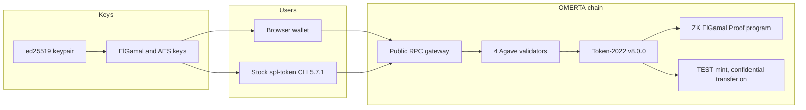
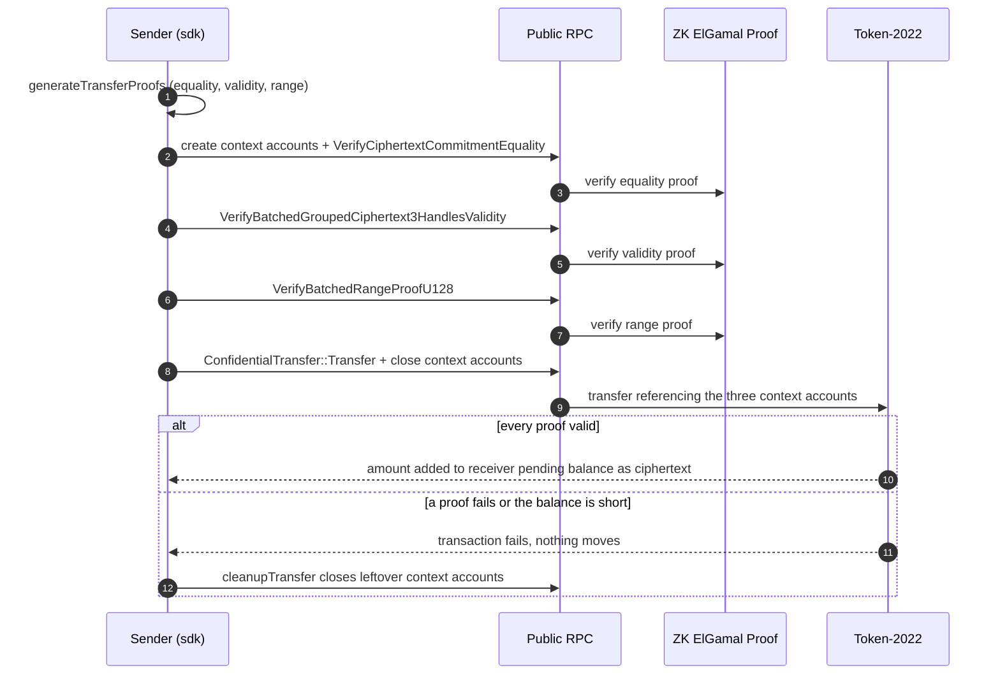
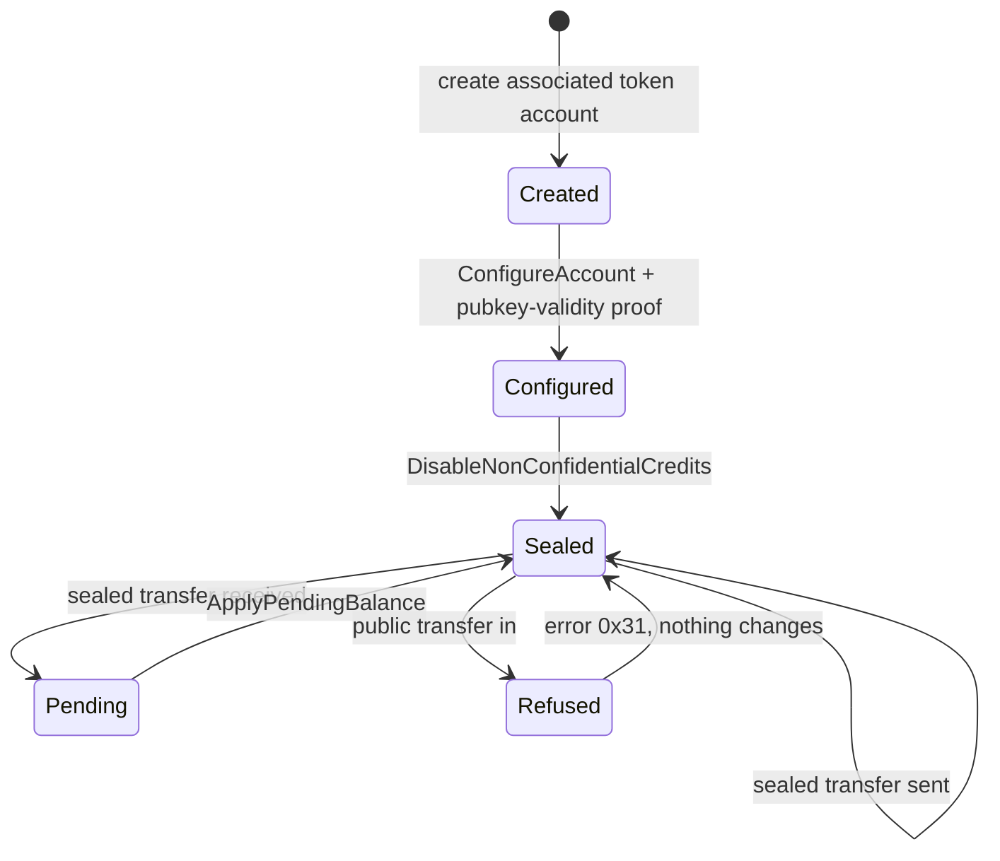
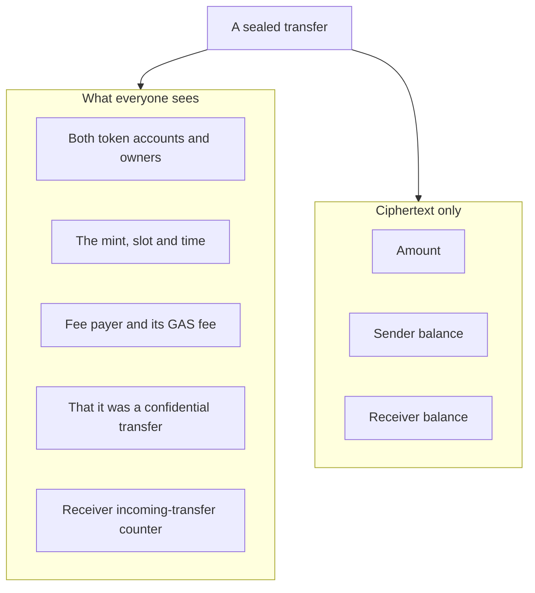

<p align="center"></p>

# OMERTA

**CA:** `29hCPsqJNs1BWEHrGgW1HXcCudgw1iRnJVWD33omerta`

<p>
  <a href="https://omerta.computer"></a>
  <a href="https://x.com/omertachain"></a>
  <a href="https://github.com/omerta-computer/omerta"></a>
  <a href="https://github.com/omerta-computer"></a>
  <a href="docs/whitepaper.md"></a>
  <a href="docs/API.md"></a>
  <a href="docs/official-tools.md"></a>
  <a href="VERIFY.md"></a>
  <a href="SECURITY.md"></a>
  <a href="LICENSE"></a>
  <a href="https://github.com/omerta-computer/omerta/actions/workflows/ci.yml"></a>
</p>

OMERTA is an Agave-based chain for confidential Token-2022 transfers. Its wallet encrypts transfer amounts and balances. Sender and recipient addresses remain public.

## Overview

OMERTA runs four project-operated validators. Token-2022 is loaded at genesis. The main test asset uses its confidential-transfer extension without an auditor key. The wallet configures each account it creates to refuse public credits. Owners can change this setting with Token-2022.

No key opens someone else's balance: not the project's, not a validator's, not an auditor's (the mint has no auditor key). A balance is opened with keys derived from the owner's own keypair, in the owner's own software, exactly the way the official `spl-token` CLI derives them, so the same keypair file opens the same balance in the stock CLI. What stays visible is listed below under *What everyone sees*: who sent to whom is public today.

This repository includes the Agave patch, genesis manifest, TypeScript SDK, chain scripts and proof benchmark. The native test coin `GAS` pays transaction fees. The mint below identifies `TEST` on the OMERTA network.

| What | Value |
|---|---|
| Engine | Agave `v4.5.0-alpha.4`, commit `ccddd3dffc7edb1d6ed8182ac8e9cbd73b24b159`, plus `chain/patches/ledger-floor.patch` |
| Token-2022 | `TokenzQdBNbLqP5VEhdkAS6EPFLC1PHnBqCXEpPxuEb` (v8.0.0 release build, in genesis) |
| ZK ElGamal Proof | `ZkE1Gama1Proof11111111111111111111111111111` (native in the engine) |
| Main asset `TEST` | `5n31rh6t9mgFYZRhoSb8k2xUcdCgmDL5BFZbjvkPLHif` (6 decimals, supply fixed, mint authority removed) |
| Legacy SPL Token | not in genesis |
| Validators | 4, all operated by the project |
| Tests | 11 offline SDK tests |

## How it works

1. **Derive.** The browser or the CLI makes an ed25519 keypair. `deriveSealKeys` derives the ElGamal and AES keys from it by signing the standard derivation message, the same derivation as `spl-token` 5.7.1.
2. **Seal.** `createSealedAccount` creates the owner's Token-2022 associated token account, reallocates it for the confidential transfer extension, sends `ConfigureAccount` with a pubkey-validity proof and `DisableNonConfidentialCredits`, all in one transaction.
3. **Receive.** A sealed transfer lands in the receiver's pending balance as ElGamal ciphertext; `applyPending` moves it to the available balance and writes the new AES-encrypted available balance.
4. **Send.** `sealedTransfer` builds the three proofs a transfer carries (ciphertext-commitment equality, batched grouped-ciphertext validity, batched 128-bit range) with `@solana/zk-sdk`, verifies them into context accounts, sends `ConfidentialTransfer::Transfer` referencing them and closes the context accounts.
5. **Open your own.** `decryptBalances` decrypts the available balance (AES) and the pending amounts (ElGamal) locally. Nobody else can.
6. **Check.** Anyone reads any account with the stock `solana` and `spl-token` CLIs and gets public balance 0 and ciphertext; a public transfer into a sealed account fails with Token-2022 `custom program error: 0x31`.

## Architecture



Both the browser wallet (this SDK) and the stock CLI derive the same encryption keys from the same keypair and reach the chain only through the public RPC. Token-2022 holds the asset logic; it asks the engine's native ZK ElGamal Proof program to check every proof, so no program written for this chain sits in the transfer path.



The default path is four transactions, each confirmed before the next, with a `TransferPlan` that `resumeTransfer` continues after an interruption. The stock CLI does the same transfer in ten transactions (it uploads the range proof through the SPL Record program). Steps and figures are measured in the whitepaper.



`createSealedAccount` creates, configures and seals an account in one transaction. The owner can later re-enable public credits.



This is the whole list of what an outsider reads from one transfer. Moving value between the public and the sealed part of an account (deposit, withdraw) and minting show their amounts, and the native coin `GAS` is public.

| Account | Derived from | Holds |
|---|---|---|
| Sealed token account | associated token address: owner, Token-2022 program id, mint | ElGamal pubkey, pending and available balance ciphertexts, AES-encrypted available balance, pending-credit counters |
| Equality context | fresh keypair per transfer | verified ciphertext-commitment equality proof context; closed in the transfer transaction |
| Validity context | fresh keypair per transfer | verified grouped-ciphertext validity proof context; closed in the transfer transaction |
| Range context | fresh keypair per transfer | verified 128-bit batched range proof context; closed in the transfer transaction |
| `TEST` mint | fixed keypair, created in the first slots | supply, decimals, confidential transfer mint extension (auto-approve, no auditor) |

## Repository structure

```
.
├── sdk/                         TypeScript SDK (sealed-transfer-sdk)
│   ├── src/
│   │   ├── index.ts             public exports
│   │   ├── keys.ts              key derivation compatible with spl-token, recovery phrase, key files
│   │   ├── proofs.ts            transfer and pubkey-validity proofs, decryption
│   │   ├── instructions.ts      Token-2022 and ZK proof instruction builders
│   │   ├── account.ts           create and seal an account, deposit, apply pending, decrypt
│   │   ├── transfer.ts          sealed transfer: plan, send, resume, clean up
│   │   ├── decode.ts            read a sealed transaction as an outsider
│   │   ├── layout.ts, rpc.ts    account layouts, sending and polling confirmation
│   │   └── constants.ts, errors.ts, zk.ts
│   ├── test/                    unit tests (no network)
│   └── e2e/                     programs that need a running chain
├── chain/
│   ├── patches/ledger-floor.patch   the one change to Agave
│   ├── genesis/programs.toml        genesis programs with ids, sources and sha256
│   └── scripts/                     genesis, base probe, main asset setup, measurement, official-tool check
├── bench/zk_proof_bench.cjs     proof cost of one transfer in the official WASM build
└── docs/                        API reference, genesis, official-tool commands, whitepaper
```

`sdk/src/keys.ts` is where compatibility with the stock CLI lives: its tests check the canonical vectors of `solana-zk-sdk` 8.1.0. `sdk/src/transfer.ts` holds the transfer state machine. `chain/scripts/genesis.sh` is the `solana-genesis` invocation of the running network, and `chain/scripts/check-official-tools.sh` runs the three checks in `docs/official-tools.md`.

## Quick start

Requirements: Node.js 22 (engines `>=20`), npm 10 or later. For the chain scripts: `spl-token-cli` 5.7.1 and the `solana` CLI 3.0.0 or later.

```
(cd sdk && npm ci && npm run build)
(cd sdk && npm run typecheck)
(cd sdk && npm test)
```

The 11 SDK tests run offline.

The package is not published to npm. To use it from your own project, build it as above and install it from this folder:

```
npm install @solana/web3.js@1.99.0 /path/to/omerta/sdk
```

```ts
import { Connection, PublicKey } from "@solana/web3.js";
import {
  ready, keypairFromFile, deriveSealKeys, sealedTokenAccountAddress, decryptBalances, sealedTransfer,
} from "sealed-transfer-sdk";
import { readFileSync } from "node:fs";

await ready();
const connection = new Connection(process.env.RPC_URL!, "confirmed");
const owner = keypairFromFile(readFileSync("me.json", "utf8"));
const mint = new PublicKey("5n31rh6t9mgFYZRhoSb8k2xUcdCgmDL5BFZbjvkPLHif");
const keys = deriveSealKeys(owner);
const source = sealedTokenAccountAddress(owner.publicKey, mint);
const destination = sealedTokenAccountAddress(new PublicKey(process.argv[2]), mint);

const { available, pending } = await decryptBalances({ connection, tokenAccount: source, keys });
await sealedTransfer({ connection, payer: owner, owner, source, destination, amount: 1_000_000n, keys });
```

Check the chain with the stock tools (`$RPC` is the public RPC URL listed on the website):

```
spl-token --url $RPC display <token-account>
solana --url $RPC account <token-account> --output json
RPC_URL=$RPC bash chain/scripts/check-official-tools.sh sender.json receiver.json out/
```

Proof cost of one transfer in Node:

```
cd sdk && npm ci && cd ..
NODE_PATH=sdk/node_modules node bench/zk_proof_bench.cjs 20
```

## Security

The reporting procedure is in `SECURITY.md`.

- A sealed account with public credits disabled rejects a public transfer with `0x31`.
- Every transfer carries three zero-knowledge proofs checked by the engine's native program before Token-2022 changes a balance.
- The SDK never sends a secret key, an ElGamal secret, an AES key or a recovery phrase over the network; only signed transactions reach the RPC.
- The SDK has no default RPC URL; every write takes an explicit `Connection`.

### Trust assumptions

- **Upgrade authority.** Token-2022, Associated Token Account and SPL Record are loaded in genesis under the non-upgradeable loader (`BPFLoader2111111111111111111111111111111111`); the core programs are under loader v3 with no upgrade authority. Nobody can upgrade them on this chain without a new genesis.
- **Admin.** The project runs all 4 validators and the one public RPC. It can stop the chain, restart it from a new genesis or change the engine; it has no admin key over the `TEST` mint (mint, freeze and confidential-transfer authorities are removed) and none over any account.
- **What no key can move.** No key of the project can move or read a sealed balance: there is no auditor key, no freeze authority and no mint authority. The project cannot move funds out of a user's account.
- **Dependencies.** Correctness depends on Token-2022 v8.0.0, the ZK ElGamal Proof program in Agave (crate `solana-zk-sdk` 8.1.0) and `@solana/zk-sdk` 0.5.4. The engine carries the feature gates `disable_zk_elgamal_proof_program` and `reenable_zk_elgamal_proof_program`: the proof program was switched off and back on upstream after a reported flaw, and this chain inherits any flaw still in it. The engine is an Agave pre-release.
- **Audit.** This repository has not been audited. The tests are not an audit.
- **Visibility.** Who sent to whom is visible. A fresh account's first balance can be guessed because the faucet grant has a fixed size.

## Repository history

The initial commits reconstruct this source snapshot in dependency order. Their dates illustrate that sequence. The original Git history was unavailable. The verification record gives the date of the checks.

## License

MIT. See `LICENSE` for the terms.
